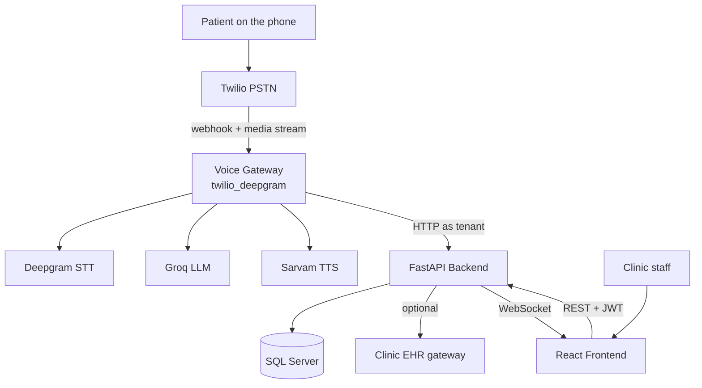
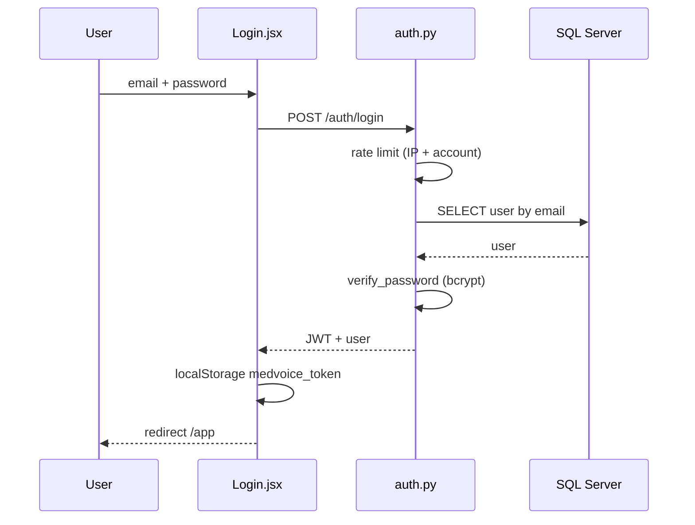
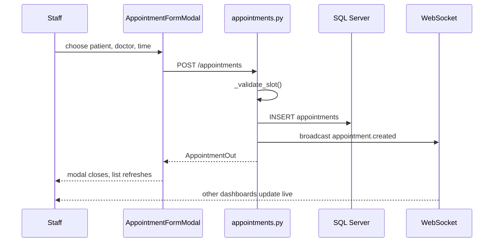
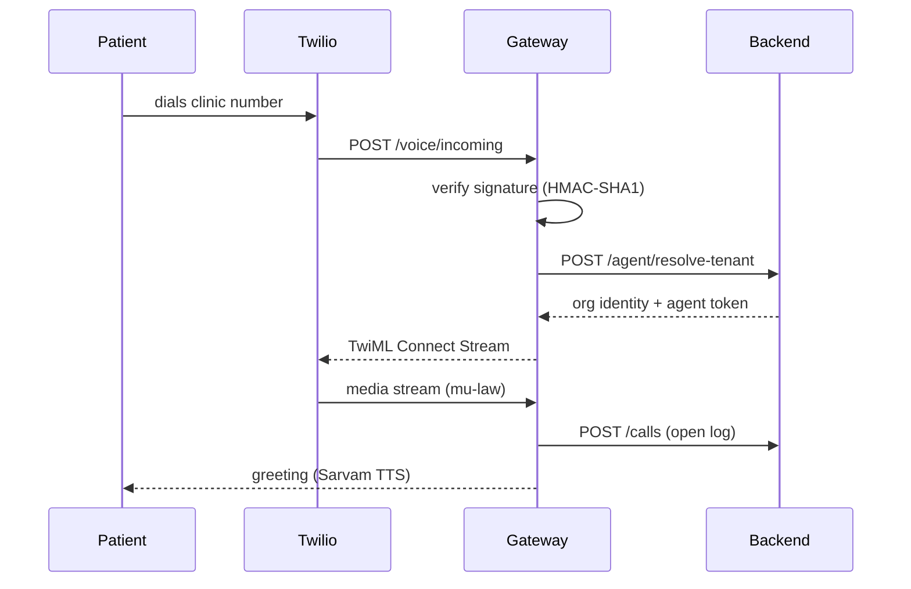
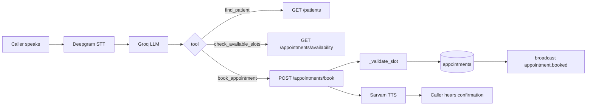
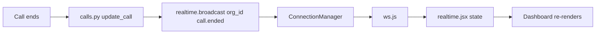

# MediCOR AI — Complete Working Flow

**AI-Powered Healthcare Voice & Workflow Automation**

*Traced from the source code in this repository. Every endpoint, function, table and
tool named here was read out of the code, not assumed. Where something could not be
confirmed, it says so.*

---

## Read this first — three corrections to common assumptions

Before anything else, three things about this system are frequently described wrongly.
All three are verified below.

| Common assumption | What the code actually does |
|---|---|
| "Calls come in over Vobiz → SIP → LiveKit" | **No.** The live stack is **Twilio Media Streams over a WebSocket** — no SIP trunk is involved. LiveKit is a *retained fallback* (`voice-agent/agent.py`), and Vobiz is a **retired** carrier. |
| "It integrates with Epic / Cerner / athenahealth" | **No.** `app/ehr_service.py` states in its own docstring: *"No real EHR vendor is hardcoded or invented."* It is a **generic FHIR/REST gateway** a clinic points at itself. With none configured, the clinic runs `local_only` and this database is the system of record. |
| "Calls are recorded" | **No.** Calls are **transcribed, never recorded**. `call_logs.recording_url` exists as a column and has **no writer anywhere** in the codebase. |

---

# 1. What is MediCOR AI?

**In one sentence:** MediCOR AI answers a clinic's telephone with an AI receptionist,
and gives the clinic a dashboard to manage everything that comes out of those calls.

### The problem it solves

A clinic's front desk is a bottleneck. Reception is on another line, at lunch, or gone at
six — and the phone keeps ringing. Every missed call is a patient who books somewhere
else, or who turns up without an appointment. Meanwhile the receptionist spends the day on
work that is repetitive: who is calling, when can they come in, what are your opening
hours, can I have a repeat prescription.

### What it does

1. **Answers every call**, out of hours and during a rush.
2. **Books, reschedules and cancels appointments** against the clinic's real availability.
3. **Answers questions from the clinic's own documents** (opening hours, fees, policies).
4. **Records repeat-prescription requests** for a human to decide on — it can never approve one.
5. **Transfers to a person** when asked, and when a caller describes an emergency.
6. **Shows the clinic everything** — live calls, transcripts, summaries, appointments —
   on a real-time dashboard.

### Who uses it

| User | What they use |
|---|---|
| **Patients** | The telephone. They never see a screen (except an optional self-service appointment link). |
| **Clinic reception / medical staff** | The dashboard — patients, appointments, calls, knowledge base. |
| **Clinic administrator** | All of the above, plus team, billing, agent settings, EHR configuration. |
| **Platform super admin** | A separate console at `/admin` — all clinics, plans, subscriptions, support. |

### Business purpose

It is sold as **multi-tenant SaaS**: one deployment serves many clinics, each isolated by
`org_id`, each with its own phone number, plan and data.

---

# 2. High-level system flow

### 2.1 The dashboard path (a human using the app)

```
Clinic user (browser)
        |
        v
React 19 + Vite frontend        src/pages/**, src/components/**
        |   fetch() via src/lib/api.js  (JWT in Authorization header)
        v
FastAPI backend                 app/main.py -> app/routers/*.py
        |
        v
Service layer                   app/*_service.py  (business logic)
        |
        v
SQLAlchemy 2.0 -> pyodbc
        |
        v
SQL Server 2022 Express
        |
        v
JSON response -> React state -> UI updates
```

### 2.2 The voice path (a patient telephoning) — **verified**

```
Patient dials the clinic number
        |
        v
Twilio  (PSTN)                       no SIP trunk on this path
        |  POST {VOICE_GATEWAY_PUBLIC_URL}/voice/incoming   (signature verified)
        v
Voice gateway  (FastAPI/uvicorn)     voice-agent/twilio_deepgram/server.py
        |  answers with <Connect><Stream> TwiML
        v
Twilio Media Stream  (WebSocket, 8 kHz mu-law, bidirectional)
        |
        v
Bridge                               voice-agent/twilio_deepgram/bridge.py
        |
        +--> Deepgram streaming STT   wss://api.deepgram.com/v1/listen
        |
        +--> LLM (Groq, OpenAI-compatible)  decides which tool to call
        |
        +--> Tool execution           voice-agent/twilio_deepgram/tools.py  (16 tools)
        |          |
        |          v
        |    Backend HTTP (org token)  ->  FastAPI  ->  SQL Server
        |
        +--> Sarvam Bulbul TTS         wss://api.sarvam.ai/text-to-speech/ws
        |
        v
Audio returned down the same Media Stream
        |
        v
Patient hears the reply
        |
   (call ends)
        v
Transcript + summary + outcome written to call_logs / transcript_messages
        |
        v
WebSocket broadcast -> dashboard updates live
```

**Audio crosses the whole pipeline without a resample** — Twilio sends 8 kHz mu-law,
Deepgram accepts it directly, Sarvam emits it.

---

# 3. Where does the application start?

### 3.1 Frontend

| Step | File | What happens |
|---|---|---|
| 1 | `src/main.jsx` | React root created, mounts `<App/>` |
| 2 | `src/App.jsx` | `BrowserRouter` + `AuthProvider` + `AdminAuthProvider` + `ErrorBoundary`; all routes declared here |
| 3 | `src/lib/auth.jsx` | Reads `medvoice_token` from `localStorage`, calls `GET /auth/me` to hydrate the user |
| 4 | `src/lib/ProtectedRoute.jsx` | Redirects to `/login` when there is no valid session |
| 5 | `src/components/AppShell.jsx` | Chrome for every signed-in page; mounts the WebSocket once |

First page for an anonymous visitor is `/` (the marketing landing page).
First page after signing in is `/app` (the Dashboard).

### 3.2 Backend

| Step | File | What happens |
|---|---|---|
| 1 | `app/main.py` | `configure_logging()` |
| 2 | `app/deployment.py` | `deployment.check()` — refuses to start on a bad production config |
| 3 | `app/instance.py` | `check_worker_configuration()` — this app must run **one worker** |
| 4 | `app/database.py` | Engine built from `app/config.py`; `AUTO_CREATE_SCHEMA=false` here, so **Alembic owns the schema** |
| 5 | `app/main.py` | `FastAPI(title="MediCOR AI API")`, middleware, then **29 routers** registered |
| 6 | startup event | `realtime_manager.bind_loop()` — lets sync handlers push WebSocket events |
| 7 | startup event | `jobs.register_all()` + `scheduler.start()` — in-process scheduled jobs |

**176 routes** are registered in total.

### 3.3 Voice gateway

| Step | File | What happens |
|---|---|---|
| 1 | `voice-agent/twilio_deepgram/run.py` | Entry point — `python -m twilio_deepgram.run`, serves **:8080** |
| 2 | `.../settings.py` | Reads `voice-agent/.env`; `startup_problems()` reports what is unconfigured |
| 3 | `.../server.py` | FastAPI app: `POST /voice/incoming`, the media WebSocket, `/health` |
| 4 | `.../twilio_api.py` | Verifies Twilio's HMAC-SHA1 signature **before** anything is read |
| 5 | `.../call_session.py` | Resolves the tenant, opens the call log |
| 6 | `.../bridge.py` | Runs the conversation |

**It is not started by the backend.** It is a separate process with its own `.env`.

---

# 4. Application navigation map

All routes are declared in `src/App.jsx`.

### Public (no account)

| Path | Page | Purpose |
|---|---|---|
| `/` | `pages/marketing/Landing.jsx` | Marketing site |
| `/privacy` | `pages/marketing/Privacy.jsx` | Privacy policy |
| `/terms` | `pages/marketing/Terms.jsx` | Terms of service |
| `/contact` | `pages/marketing/Contact.jsx` | Contact form → `POST /public/contact` |
| `/login` | `pages/Login.jsx` | Clinic sign-in |
| `/accept-invite` | `pages/AcceptInvite.jsx` | Staff invitation |
| `/reset-password` | `pages/ResetPassword.jsx` | Password reset |
| `/appointment` | `pages/PatientAppointment.jsx` | **Patient self-service link** (token in URL) |

### Clinic application (JWT required)

| Path | Page | Loads on open |
|---|---|---|
| `/app` | `pages/app/Dashboard.jsx` | `GET /dashboard/stats`, `GET /dashboard/call-volume` |
| `/app/calls` | `pages/app/CallLogs.jsx` | `GET /calls` |
| `/app/appointments` | `pages/app/Appointments.jsx` | `GET /appointments`, `GET /patients`, `GET /doctors` |
| `/app/patients` | `pages/app/Patients.jsx` | `GET /patients` |
| `/app/patients/:id` | `pages/app/PatientProfile.jsx` | `GET /patients/{id}`, history, appointments |
| `/app/knowledge-base` | `pages/app/KnowledgeBase.jsx` | `GET /knowledge-base/*` |
| `/app/clinic` | `pages/app/ClinicProfile.jsx` | `GET /clinic-info`, `GET /doctors`, `GET /services` |
| `/app/ehr` | `pages/app/EHRIntegration.jsx` | `GET /ehr/integrations` |
| `/app/agent` | `pages/app/AgentSettings.jsx` | `GET /agent-settings` |
| `/app/analytics` | `pages/app/Analytics.jsx` | `GET /analytics/*` |
| `/app/billing` | `pages/app/Billing.jsx` | `GET /billing/plan`, `/invoices`, `/payments` |
| `/app/team` | `pages/app/Team.jsx` | `GET /users` |
| `/app/security` | `pages/app/Security.jsx` | `GET /security/*` |
| `/app/support` | `pages/app/Support.jsx` | `GET /support/docs`, `GET /support/tickets` |

### Platform console (separate token)

`/admin/login`, `/admin` and its sub-pages — organisations, plans, subscriptions, usage,
phone numbers, support, audit log. **Deliberately a separate auth context**
(`medvoice_admin_token`) so an admin and a clinic session can coexist in two tabs.

---

# 5. Login & authentication flow

### Manager-friendly explanation

> A staff member signs in with their email and password. The server checks the password
> against a hash — it never stores the password itself — and hands back a signed token.
> The browser keeps that token and attaches it to every later request. The server checks
> the signature on each one, so nobody can forge access. If the token is missing or
> expired, the app sends them back to the login screen.

### Technical flow

```
CLICK "Sign in"                     pages/Login.jsx
        |
        v
api.login(email, password)          src/lib/api.js:60
        |   POST /auth/login   (x-www-form-urlencoded: username, password)
        v
app/routers/auth.py :: login()
        |
        +-- rate_limit.enforce_rate_limit()          per IP
        +-- rate_limit.enforce_account_rate_limit()  per email address
        |
        v
User lookup by email  ->  models.User
        |
        v
security.verify_password(plain, user.hashed_password)      bcrypt
        |
        v
security.create_access_token({"sub": user.id})             JWT, no `typ` claim
        |
        v
{ access_token, token_type, user }
        |
        v
setToken() -> localStorage["medvoice_token"]
        |
        v
AuthProvider hydrates -> ProtectedRoute allows -> redirect to /app
```

### Three token families that never cross — `app/security.py`

| Token | `typ` claim | Accepted by | Used for |
|---|---|---|---|
| **Staff** | *none* | `get_current_user`, `require_admin` | The clinic dashboard |
| **Super admin** | `super_admin` | `get_current_super_admin` | `/admin/*` console |
| **Agent** | `agent` | `get_org_context` **only** | The voice agent, per call |

Each decoder rejects the other two. A suspended organisation is rejected in all paths.

**Important, and worth stating honestly:** resetting a password does **not** invalidate
existing sessions. The JWTs are stateless with no revocation list.

---

# 6. Screen-by-screen analysis

---

## SCREEN: Login

**`[ADD SCREENSHOT — LOGIN PAGE]`**

**1. Purpose** — Gets a staff member into the clinic dashboard.

**2. What the user sees** — Email and password fields, a sign-in button, a link to reset
a forgotten password, and a panel describing what the product does.

**3. How they reach it** — `/login`, or by being redirected there from any `/app/*` route
without a valid session.

**4. APIs called on load** — None. The page is static until submitted.

**5. Important actions** — Sign in; Forgot password.

**6. What I can say to my manager**

> "This is the sign-in screen. Credentials are checked on the server against a hashed
> password, and the browser gets back a signed token that authorises every later request.
> Login is rate limited two ways — per IP address and per email account — so a brute-force
> attempt is throttled even if it comes from many machines."

**7. Technical flow** — see section 5.

**8. Final result** — Redirect to `/app`, the Dashboard.

---

## SCREEN: Dashboard

**`[ADD SCREENSHOT — DASHBOARD]`**

**1. Purpose** — The clinic's at-a-glance view: what happened today, what is happening now.

**2. What the user sees** — Stat cards, a call-volume chart, recent activity, live-call
banner, onboarding checklist, notifications.

**3. How they reach it** — Automatically after login; the sidebar "Overview" item.

**4. APIs called on load**

| Method | Endpoint | Frontend fn | Backend | Source of truth |
|---|---|---|---|---|
| GET | `/dashboard/stats` | `api.getDashboardStats()` | `routers/dashboard.py :: get_stats` | `analytics_service` over `call_logs`, `appointments` |
| GET | `/dashboard/call-volume` | `api.getCallVolume()` | `routers/dashboard.py` | `call_logs` |
| WS | `/ws/dashboard?token=` | `src/lib/ws.js` | `routers/ws.py` | `realtime.ConnectionManager` |

**5. Stat cards — where each number comes from**

| Card | Field | Derivation |
|---|---|---|
| Calls handled | `calls_handled_today` | Count of `call_logs` today, in the clinic's timezone |
| Appointments booked | `appointments_booked_today` | Count of `appointments` created today |
| Resolved by AI | `resolution_rate_pct` | `analytics_service.resolution_rate` — excludes `failed`/`no_answer` from the denominator |
| Staff time saved | `staff_time_saved_hrs` | Derived from AI-handled minutes |

**Honest note:** "Resolved by AI" renders an em dash rather than `0%` when no calls
connected — 0% would read as "the AI failed every call" instead of "nothing to measure".

**6. What I can say to my manager**

> "This is the clinic's daily view. Every number here is computed from real call and
> appointment records — nothing is stored pre-aggregated, so it cannot drift. The dashboard
> also holds an open WebSocket, so when a patient call starts or ends, this screen updates
> without anyone refreshing."

**7. Technical flow**

```
Dashboard mounts -> useEffect
  -> api.getDashboardStats()  -> GET /dashboard/stats
  -> routers/dashboard.py -> analytics_service -> SQLAlchemy -> SQL Server
  -> JSON -> setStats() -> cards render
Simultaneously: ws.js opens /ws/dashboard?token=...
  -> realtime.ConnectionManager registers the socket under org_id
```

**8. Final result** — Populated cards and chart; live updates thereafter.

---

## SCREEN: Patients

**`[ADD SCREENSHOT — PATIENTS PAGE]`**

**1. Purpose** — The clinic's patient roster: find, add and open a patient.

**2. What the user sees** — A search box, a table of patients, an "Add Patient" button.

**3. How they reach it** — Sidebar → Patients (`/app/patients`).

**4. APIs on load** — `GET /patients` → `routers/patients.py :: list_patients` → `patients` table, filtered by `org_id`.

**5. Important actions** — Search; Add Patient (opens `PatientFormModal`); click a row → `/app/patients/:id`.

**6. What I can say to my manager**

> "This is the patient list for this clinic only — every query is scoped to the
> organisation, so one clinic can never see another's records. Search matches name, phone
> or MRN. Phone search is smarter than it looks: it matches on the last ten digits, so a
> number saved as `8688460308` still matches a call arriving as `+918688460308`."

**7/8.** See the Add Patient and Search button flows in section 7.

---

## SCREEN: Patient Profile

**`[ADD SCREENSHOT — PATIENT DETAILS]`**

**1. Purpose** — Everything known about one patient.

**2. What the user sees** — Demographics, appointments, prescriptions, interaction history,
call history, consent state, and a disabled "call patient" control.

**4. APIs on load** — `GET /patients/{id}`, plus that patient's appointments and history.

**Audit note:** opening this page writes a `patient.viewed` row to `audit_log`.
Individual-record reads are audited; list endpoints deliberately are not.

**6. What I can say to my manager**

> "Opening a patient record is itself recorded in the audit log — who looked, at what, and
> when. The audit log stores field *names* when something changes, never the values, so it
> never becomes a second copy of the medical record with a wider audience."

**Honest note:** the "place a call to this patient" button is **deliberately disabled**
with a tooltip explaining why. Outbound dialling from the dashboard is not built.

---

## SCREEN: Appointments

**`[ADD SCREENSHOT — APPOINTMENTS PAGE]`**

**1. Purpose** — The clinic's calendar: see, book, reschedule and cancel.

**4. APIs on load** — `GET /appointments`, `GET /patients`, `GET /doctors`.

**5. Important actions** — New appointment; reschedule; cancel; change status.

**6. What I can say to my manager**

> "This is the clinic's calendar. When a slot is booked — by staff here, or by the AI on a
> phone call — it goes through exactly the same validation code. That matters: there is one
> definition of 'is this slot free', so the AI cannot book something a human couldn't."

---

## SCREEN: Call Logs

**`[ADD SCREENSHOT — CALL LOGS PAGE]`**

**1. Purpose** — Every call the AI has handled, with its transcript and outcome.

**4. APIs on load** — `GET /calls` → `routers/calls.py`.
Opening one calls `GET /calls/{id}` and writes `call.transcript_viewed` to the audit log.

**5. Important actions** — Open a call; export to CSV (`POST /calls/export`, audited as
`call_log.exported`); the Quality tab (`/app/calls?tab=quality`).

**6. What I can say to my manager**

> "Every call is here with its full transcript, an AI-written summary, the sentiment, and
> the outcome. Note what the outcome does *not* do — it only says 'Booked' if there is an
> actual appointment record attached. The AI saying it booked something is not enough."

**Honest note:** there is **no audio recording** to play. Calls are transcribed only.

---

## SCREEN: EHR Integration

**`[ADD SCREENSHOT — EHR PAGE]`**

**1. Purpose** — Point the clinic's deployment at their own EHR, and configure webhooks.

**4. APIs on load** — `GET /ehr/integrations`, `GET /ehr/webhook`.

**6. What I can say to my manager**

> "This is where a clinic connects their existing records system. We don't ship
> vendor-specific connectors — you give it your FHIR or REST endpoint and a key. If you
> don't connect anything, the agent still works completely; this database is simply the
> system of record."

**Honest note:** 🔵 **No live EHR is configured in this deployment.** Every org is
`local_only` until someone enters a gateway URL and credentials.

---

## SCREEN: Billing

**`[ADD SCREENSHOT — BILLING PAGE]`**

**4. APIs on load** — `GET /billing/plan`, `GET /billing/invoices`, `GET /billing/payments`.

**5. Important actions** — Pay for a plan (Razorpay checkout); open an invoice document.

**Honest note:** ⚠️ Razorpay is **implemented but not configured**. With no keys,
`POST /billing/checkout` answers **503** and the page says online payment is not switched
on. Plans are then assigned by a super admin.

---

# 7. Button-by-button analysis

---

## BUTTON: Sign in

| | |
|---|---|
| **Frontend** | `src/pages/Login.jsx` → `api.login()` (`src/lib/api.js:60`) |
| **API** | `POST /auth/login` — form-encoded `username`, `password` |
| **Backend** | `app/routers/auth.py :: login()` |
| **Service** | `app/security.py` — `verify_password`, `create_access_token` |
| **Database** | `SELECT` on `users` by email |
| **External** | None |
| **Response** | `{ access_token, token_type, user }` |
| **Frontend update** | `setToken()` → `localStorage`, AuthProvider populated |
| **UI result** | Redirect to `/app` |

---

## BUTTON: Add Patient → Save

| | |
|---|---|
| **Frontend** | `src/components/PatientFormModal.jsx` → `api.createPatient(payload)` |
| **API** | `POST /patients` |
| **Backend** | `app/routers/patients.py :: create_patient()` |
| **Database** | Duplicate check, then `INSERT` into `patients`; `audit_log` row |
| **Response** | The created patient, **or `409`** |
| **UI result** | Modal closes, list refreshes — or the 409 message is shown in the modal |

**The important behaviour here is the duplicate guard**, and it answers two callers
differently:

| Caller | Answer |
|---|---|
| Staff (`ctx.actor == "user"`) | **409**, naming the existing record and its MRN |
| The voice agent (`service`) | **The existing patient** — a 4xx mid-call would strand a caller |

A duplicate is **the same name on the same phone line**, not merely the same number —
households share a handset, so a spouse or child must still be registrable.

---

## BUTTON: Search Patient

| | |
|---|---|
| **Frontend** | `src/pages/app/Patients.jsx` → `api.listPatients({ search })` |
| **API** | `GET /patients?search=...` |
| **Backend** | `app/routers/patients.py :: list_patients()` |
| **Database** | `SELECT` on `patients`, `org_id` filtered |

**Three matching rules**, all in `routers/patients.py`:

1. The original `ILIKE '%term%'` on name/phone/MRN.
2. **Plus**, when the term is phone-shaped, its **last ten digits** against the stored
   number with formatting stripped (`_phone_digits_sql`).
3. A **seven-digit floor** — shorter terms stay a plain substring search, because matching
   the *wrong* patient is far worse than matching none.

**This was a real bug, not a nicety.** Twilio delivers `+918688460308`; receptionists type
`8688460308`. The substring never matched, so caller recognition matched nobody — and the
agent then registered returning patients again as new.

---

## BUTTON: Book Appointment

```
CLICK "Book"
        |
        v
src/components/AppointmentFormModal.jsx
        |
        v
api.createAppointment(payload)            src/lib/api.js:180
        |   POST /appointments
        v
app/routers/appointments.py :: create_appointment()
        |
        +--> _get_org_patient_or_404()     org-scoped
        +--> _get_org_doctor_or_404()      org-scoped
        +--> _validate_slot()              <-- the shared rule
        |
        v
INSERT into appointments
        |
        +--> audit_service.record("appointment.created")
        +--> realtime.broadcast(org_id, "appointment.created")
        +--> BackgroundTasks: ehr_service sync, notification_service confirmation
        |
        v
AppointmentOut JSON
        |
        v
Modal closes -> list refreshes -> new row appears
        |
        v
Every other open dashboard updates via WebSocket
```

**`_validate_slot` is the single definition of a bookable slot** and is called by the
staff route, the agent route (`POST /appointments/book`) and the patient self-service
link. Reimplementing it anywhere else is how the three would drift apart.

---

## BUTTON: Reschedule / Cancel

| | Reschedule | Cancel |
|---|---|---|
| **API** | `PATCH /appointments/{id}` | `PATCH /appointments/{id}` (status) or `DELETE /appointments/{id}` |
| **Backend** | `update_appointment()` | `update_appointment()` / `delete_appointment()` |
| **Validation** | `_validate_slot()` on the new time | — |
| **Side effect** | `confirmation_status` cleared (they confirmed the *old* time) | Slot released; waiting-list sweep can offer it on |
| **Event** | `appointment.rescheduled` | `appointment.cancelled` |

---

## BUTTON: Export call logs

| | |
|---|---|
| **API** | `POST /calls/export` |
| **Backend** | `app/routers/calls.py` |
| **Audit** | `call_log.exported` — records that N records left as **one bulk pull** |
| **UI result** | CSV download |

The Time column is the **clinic's wall clock**, not the viewer's locale, so two people's
exports of the same call agree.

---

## BUTTON: Pay for a plan

```
CLICK "Pay ..."
        |
        v
src/components/PlanCheckout.jsx :: buy(planName)
        |   POST /billing/checkout   { plan_name }        <-- NO price is sent
        v
app/routers/billing.py :: create_checkout()
        |   amount read from Plan.monthly_price_cents
        v
payment_service.create_order()  ->  Razorpay Orders API
        |
        v
INSERT into payments (status="created")
        |
        v
Razorpay Checkout opens in the browser
        |   patient/clinic pays
        v
handler -> POST /billing/checkout/verify  { order_id, payment_id, signature }
        |
        v
verify_checkout_signature()  HMAC-SHA256, key secret
        |
        v
billing_service.fulfil_payment()   idempotent
        |
        +--> payments.status = "captured"
        +--> Subscription created/updated, org.plan mirrored
        +--> INSERT into invoices (payment_id set)
```

**The price never comes from the client** — the request carries a plan *name* only.

---

## Actions with NO backend call

> **No backend API is called. These are handled entirely on the frontend.**

- Sidebar navigation between pages (React Router only)
- Dark/light theme toggle (`src/lib/theme.js`, `localStorage`)
- Opening/closing modals and tabs
- Dismissing the onboarding checklist (`localStorage`)
- Client-side form validation before submit

---

# 8. Voice AI call flow — step by step

Each step below names the file that performs it.

| # | Step | Where |
|---|---|---|
| 1 | Patient dials the clinic's number | Twilio PSTN |
| 2 | Twilio POSTs the webhook | → `POST /voice/incoming` |
| 3 | **Signature verified before anything is read** | `twilio_api.verify_signature()` — HMAC-SHA1, fails closed |
| 4 | Dialled number (`To`) and caller (`From`) taken from the form | `server.py` |
| 5 | Tenant resolved | `POST /agent/resolve-tenant` with `X-Platform-Key` → `phone_numbers.e164` → org identity + short-lived **agent token** |
| 6 | TwiML returned | `<Connect><Stream>` naming the gateway's own WebSocket |
| 7 | Twilio opens the media stream | 8 kHz mu-law, base64, bidirectional |
| 8 | Call log opened | `call_session.py` → `POST /calls` |
| 9 | Greeting spoken | `call_session.greeting()` |
| 10 | Caller audio → **Deepgram STT** | `pipeline/stt.py` |
| 11 | Transcript → **LLM (Groq)** | `pipeline/llm.py` |
| 12 | LLM selects a **tool** | `tools.py` — 16 discrete functions |
| 13 | Tool runs as its own task | so audio never stops during an HTTP round trip |
| 14 | Tool calls the backend | over HTTP as the resolved tenant |
| 15 | Backend hits SQL Server | ordinary routers — the same ones the dashboard uses |
| 16 | Result returned to the LLM | narrow, deliberately |
| 17 | Reply → **Sarvam Bulbul TTS** | `pipeline/tts.py` |
| 18 | Audio returned to Twilio | down the same WebSocket |
| 19 | Caller interrupts? | `{"event":"clear"}` sent to Twilio — **barge-in is not free** |
| 20 | Call ends | drain, then finalise **exactly once** |
| 21 | Summary + sentiment + outcome | `call_intelligence.py`, upgraded by `llm_service.py` |
| 22 | Dashboard updated | `realtime.broadcast(org_id, "call.ended")` |

### Four rules in `bridge.py` that are load-bearing

1. **Barge-in requires three things together** — Twilio `clear`, abandoning the reply, and
   discarding in-flight audio. Without the `clear`, interruption *appears* broken while
   every component reports success.
2. **Tool calls run as separate tasks**, with a holding phrase after a delay — otherwise
   the caller hears the line die during a booking.
3. **Teardown drains before it finalises** — Twilio's `stop` and the last STT events race,
   so cutting immediately drops the final turn from the transcript, silently.
4. **The call ends exactly once** — four routes reach teardown and must write one record.

---

# 9. Voice agent tools (all 16, from `tools.py`)

| Tool | Purpose | Backend endpoint | Table |
|---|---|---|---|
| `find_patient` | Identify the caller | `GET /patients?search=` | `patients` |
| `register_patient` | Add a new caller | `POST /patients` | `patients` |
| `get_patient_history` | Past visits/notes | `GET /patients/{id}` | `interactions` |
| `list_doctors` | Who is available | `GET /doctors` | `doctors` |
| `check_available_slots` | Free times | `GET /appointments/availability` | `appointments` |
| `book_appointment` | Create a booking | `POST /appointments/book` | `appointments` |
| `get_patient_appointments` | Their bookings | `GET /appointments/patient/{id}` | `appointments` |
| `reschedule_appointment` | Move a booking | `PATCH /appointments/{id}` | `appointments` |
| `cancel_appointment` | Cancel | `PATCH`/`DELETE /appointments/{id}` | `appointments` |
| `clinic_info` | Hours, address | `GET /clinic-info` | `clinic_info` |
| `list_services` | Services and fees | `GET /services` | `services` |
| `answer_question` | Answer from documents | `POST /knowledge-base/ask` | `kb_chunks` |
| `request_refill` | Record a refill request | `POST /refills` | `refill_requests` |
| `speak_slower` | Accessibility | (reported on finalise) | `patients` |
| `transfer_to_human` | Put through to a person | Twilio REST redirect | — |
| `end_call` | Hang up | closes the WebSocket | — |

### Two boundaries worth keeping

- **Tools are client-side.** No tool schema carries an `endpoint`. A server-side tool would
  mean handing the model provider the org token that reads and writes one clinic's patient
  records.
- **`request_refill` records; it can never approve.** That is enforced by the *dependency*
  on each route in `routers/refills.py`, not by prompt wording — a prompt is a request, a
  dependency is a rule.

---

# 10. Voice AI conversation example — booking

> **Patient:** "Hi, I'd like to book an appointment for tomorrow morning."

```
Audio (8 kHz mu-law)
   -> Deepgram STT           "I'd like to book an appointment for tomorrow morning"
   -> LLM (Groq)             intent: book; caller not yet identified
   -> tool: find_patient     GET /patients?search=+918688460308
   -> backend                exactly one match -> "Krishna"
   -> LLM                    "Am I speaking with Krishna?"          [first name only]
   -> Sarvam TTS -> patient

> Patient: "Yes, that's me."

   -> tool: check_available_slots   GET /appointments/availability?doctor_id=&date=
   -> backend                       computes free slots in the CLINIC'S timezone
   -> LLM                           "I have 9:30, 10:15 or 11 o'clock."

> Patient: "10:15 please."

   -> tool: book_appointment        POST /appointments/book
   -> _validate_slot()              the same rule staff booking uses
   -> INSERT appointments
   -> realtime.broadcast("appointment.booked")   -> dashboard updates live
   -> LLM                           "Booked for 10:15 tomorrow."
   -> Sarvam TTS -> patient
```

**Why first name only:** reading a full name aloud would confirm to whoever picked up the
phone that a specific named person is a patient of this clinic. The prompt is also told the
name is a *guess* — recognition **greets, it does not authenticate**.

---

# 11. EHR flow

```
Staff or voice agent
        |
        v
Backend router
        |
        v
app/ehr_service.py :: get_active_integration(org_id)
        |
        +-- no connected row, or no credentials  -> status "local_only" / "not_configured"
        +-- plan does not grant EHR access       -> returns None  (degrades, never 403s)
        +-- configured                            -> outbound HTTPS to the clinic's gateway
        |                                             (bounded retry on transient failures)
        v
Result: "synced" | "not_configured" | "unavailable" | "local_only"
```

**What is synced outward:** MRN, name, date of birth, phone, status.

**Rules that matter**

- 🔵 **No real vendor is implemented.** The docstring says so explicitly.
- **It never breaks the caller.** Returns a status rather than raising, and runs from
  `BackgroundTasks`. A booking must succeed even when the EHR is down.
- **The plan gate lives inside `get_active_integration`** so a new EHR endpoint cannot
  forget it.
- **Anything the voice agent can reach degrades, never 403s** — a caller must never hear
  about a billing problem.

---

# 12. Real-time / WebSocket flow

```
Something happens (call starts, appointment booked)
        |
        v
Router calls realtime.broadcast(org_id, event, data)     synchronous
        |
        v
app/realtime.py hands off to the bound loop  (run_coroutine_threadsafe)
        |
        v
ConnectionManager -> every socket registered under that org_id
        |
        v
src/lib/ws.js  (token as a query param — WS handshakes can't carry headers)
        |
        v
src/lib/realtime.jsx  -> React state
        |
        v
Dashboard updates with no refresh
```

### Events actually broadcast — verified

`call.started` · `call.updated` · `call.ended` ·
`appointment.created` · `appointment.updated` · `appointment.booked` ·
`appointment.rescheduled` · `appointment.cancelled`

Plus `notification` via `realtime.notify()`, which — unlike `broadcast()` — **also writes a
`notifications` row** before broadcasting, so the live copy and the fetched-history copy
are the same object rather than duplicates.

**Constraint:** this fan-out is **in-process**. The app must run **one worker**; a second
gets its own copy of the socket registry and its own rate-limit counters.

---

# 13. Database

**SQL Server 2022 Express**, accessed through SQLAlchemy 2.0 + pyodbc.
**39 tables.** Schema is owned by **Alembic** (`AUTO_CREATE_SCHEMA=false`), currently at
revision `0036_payments`.

### Core entities

| Table | Purpose | Key relationships |
|---|---|---|
| `organizations` | The tenant | Parent of nearly everything |
| `users` | Clinic staff | → `organizations` |
| `patients` | Patient records | → `organizations` |
| `doctors` | Clinicians | → `organizations` |
| `appointments` | Bookings | → `patients`, `doctors`, `organizations` |
| `call_logs` | One row per call | → `organizations`, optional `patients`, `appointments` |
| `transcript_messages` | What was said | → `call_logs` |
| `prescriptions` | Medication records | → `patients` |
| `refill_requests` | Repeat requests | → `patients`, optional `prescriptions` |
| `interactions` | Visit history | → `patients` |
| `phone_numbers` | Number → clinic routing | Globally unique `e164` |
| `audit_log` | Who did what | → `organizations` |
| `kb_documents` / `kb_chunks` | Knowledge base + vectors | → `organizations` |
| `plans` / `subscriptions` / `payments` / `invoices` | Commercial | → `organizations` |

### Relationship shape

```
organizations
   |-- users
   |-- doctors ------------+
   |-- patients -----------+---> appointments
   |      |-- prescriptions        ^
   |      |-- interactions         |
   |      |-- refill_requests      |
   |-- call_logs ------------------+   (optional link)
   |      |-- transcript_messages
   |-- phone_numbers
   |-- kb_documents -> kb_chunks
   |-- audit_log
```

### Rules that constrain how code is written here

- **Every table except `transcript_messages`, `prescriptions` and `interactions` carries
  `org_id`**, and there is **no automatic tenant filter** — every query must filter
  explicitly. The one confirmed cross-org IDOR in this codebase's history came from
  checking the parent's org but not the child's.
- **Two kinds of naive datetime coexist.** `appointments.start_at` is **clinic wall-clock**;
  `occurred_at`/`created_at` are **UTC**. Confusing them shifts a UTC+5:30 clinic's
  reminder window by five and a half hours — and does not error.
- **Bare `Column(String)` becomes `VARCHAR(MAX)`** on SQL Server, which cannot be indexed
  or made unique. Indexable columns need an explicit length.

---

# 14. API flow map (representative)

| Feature | Method | Endpoint | Frontend fn | Backend router | Service | Storage |
|---|---|---|---|---|---|---|
| Login | POST | `/auth/login` | `api.login` | `auth.py` | `security.py` | `users` |
| Session | GET | `/auth/me` | `api.me` | `auth.py` | `deps.py` | `users` |
| Dashboard | GET | `/dashboard/stats` | `api.getDashboardStats` | `dashboard.py` | `analytics_service` | `call_logs`, `appointments` |
| Patient list | GET | `/patients` | `api.listPatients` | `patients.py` | — | `patients` |
| Create patient | POST | `/patients` | `api.createPatient` | `patients.py` | `audit_service` | `patients` |
| Appointments | GET | `/appointments` | `api.listAppointments` | `appointments.py` | — | `appointments` |
| Availability | GET | `/appointments/availability` | `api.getAvailability` | `appointments.py` | `timezones` | `appointments` |
| Book (staff) | POST | `/appointments` | `api.createAppointment` | `appointments.py` | `_validate_slot` | `appointments` |
| Book (agent) | POST | `/appointments/book` | *(voice tool)* | `appointments.py` | `_validate_slot` | `appointments` |
| Calls | GET | `/calls` | `api.listCalls` | `calls.py` | — | `call_logs` |
| Ask the KB | POST | `/knowledge-base/ask` | `api.askKnowledgeBase` | `knowledge_base.py` | `rag_service` | `kb_chunks` |
| Tenant resolve | POST | `/agent/resolve-tenant` | *(gateway)* | `agent_runtime.py` | — | `phone_numbers` |
| Live updates | WS | `/ws/dashboard` | `src/lib/ws.js` | `ws.py` | `realtime` | in-memory |
| Checkout | POST | `/billing/checkout` | `api.createCheckout` | `billing.py` | `payment_service` | `payments` |
| Razorpay hook | POST | `/webhooks/razorpay` | *(Razorpay)* | `payment_webhook.py` | `billing_service` | `payments` |

**Five unauthenticated routers**, each deliberate: `appointment_link.py` (patient
self-service, token-scoped), `inbound_messages.py` (Twilio, signature-verified),
`public_catalog.py` (plans + contact form), `payment_webhook.py` (Razorpay,
signature-verified), and the voice gateway's own webhook.

---

# 15. End-to-end journeys (condensed)

| # | Journey | Path |
|---|---|---|
| 1 | Admin login | Login → `POST /auth/login` → JWT → `/app` |
| 2 | Open dashboard | `GET /dashboard/stats` + WS connect → cards render |
| 3 | Add patient | Modal → `POST /patients` → duplicate guard → INSERT → list refresh |
| 4 | Search patient | `GET /patients?search=` → 3 matching rules → table |
| 5 | View patient | `GET /patients/{id}` → `patient.viewed` audited → profile |
| 6 | Book appointment | Modal → `POST /appointments` → `_validate_slot` → INSERT → broadcast |
| 7 | Reschedule | `PATCH /appointments/{id}` → re-validate → confirmation cleared |
| 8 | Cancel | `PATCH`/`DELETE` → slot released → waiting-list sweep may offer it |
| 9 | Patient calls | Twilio → webhook (signature) → tenant resolve → media stream |
| 10 | AI identifies caller | `find_patient` → exactly one match → greet by first name |
| 11 | AI checks availability | `check_available_slots` → `GET /appointments/availability` |
| 12 | AI books | `book_appointment` → `POST /appointments/book` → `_validate_slot` |
| 13 | AI answers a question | `answer_question` → `POST /knowledge-base/ask` → local embeddings |
| 14 | Call ends | drain → finalise once → summary/sentiment/outcome |
| 15 | Dashboard live update | `realtime.broadcast` → WS → React state → UI |

---

# 16. Implementation status

| Feature | Status | Note |
|---|---|---|
| Authentication, JWT, RBAC | 🟢 | Three token families, tests pin the boundaries |
| Patients (CRUD, search, duplicate guard) | 🟢 | |
| Appointments (book/reschedule/cancel/availability) | 🟢 | One shared `_validate_slot` |
| Call logs, transcripts, summaries | 🟢 | |
| Audit trail | 🟢 | Field names, never values |
| Real-time dashboard (WebSocket) | 🟢 | Single-worker only |
| Knowledge base + RAG | 🟢 | Embeddings run **locally** (fastembed/ONNX) |
| Multi-tenancy | 🟢 | `org_id` everywhere; no automatic filter |
| Scheduled jobs | 🟢 | Claimed via a UNIQUE row, not a timer |
| Voice gateway (Twilio + Deepgram + Sarvam) | ⚠️ | Code complete; **API keys not purchased** |
| Outbound webhooks (F14) | 🟢 | HMAC-signed, bounded retries |
| Razorpay payments | ⚠️ | Complete + tested; **keys not configured** → 503 |
| EHR integration | 🔵 / ⚠️ | Generic gateway; **no vendor, none configured** |
| SMS / WhatsApp messaging | ⚠️ | Twilio Messages API; not configured |
| Email (SMTP) | ⚠️ | Not configured |
| Auto call-quality evaluation | ⚠️ | Built, **off by default** — each judged call is a paid request |
| Call **audio recording** | 🔴 | Column exists, **no writer**. Transcripts only |
| Outbound call from dashboard | 🔴 | Button deliberately disabled with an explanation |
| `POST /billing/upgrade` | 🔴 | **501 by design** — it once granted Enterprise free |
| Hindi / Telugu on the live stack | 🔴 | English only; legacy LiveKit agent is the only multilingual path |
| Multi-worker / horizontal scaling | 🔴 | Needs Redis |

### Frontend/backend mismatches found

- `payment_label` / `payment_expires` are still returned by `GET /billing/plan` but are
  **no longer read** by the UI — they held seeded demo values ("Visa ending in 4242").
- The legacy `POST /billing/upgrade` exists and is intentionally unreachable from the UI.

---

# 17. Important source files

| Area | File | Responsibility |
|---|---|---|
| Frontend entry | `src/main.jsx` | React root |
| Frontend routing | `src/App.jsx` | All routes, providers |
| API client | `src/lib/api.js` | 108 wrappers, JWT injection |
| Admin API client | `src/lib/adminApi.js` | Separate token |
| Auth context | `src/lib/auth.jsx` | Session state |
| WebSocket | `src/lib/ws.js`, `src/lib/realtime.jsx` | Live updates |
| Dashboard | `src/pages/app/Dashboard.jsx` | Stats + chart |
| Patients | `src/pages/app/Patients.jsx`, `PatientProfile.jsx` | Roster and record |
| Appointments | `src/pages/app/Appointments.jsx` | Calendar |
| Calls | `src/pages/app/CallLogs.jsx` | Transcripts |
| Backend entry | `app/main.py` | App, routers, startup |
| Config | `app/config.py` | All settings |
| Deployment checks | `app/deployment.py` | Refuses a bad production config |
| Auth | `app/routers/auth.py`, `app/security.py`, `app/deps.py` | Login, JWT, dependencies |
| Patients API | `app/routers/patients.py` | CRUD, phone matching, duplicate guard |
| Appointments API | `app/routers/appointments.py` | `_validate_slot`, booking |
| Calls API | `app/routers/calls.py` | Call lifecycle |
| Models | `app/models.py` | 39 tables |
| Real-time | `app/realtime.py` | Org-scoped fan-out |
| EHR | `app/ehr_service.py` | Generic gateway |
| RAG | `app/rag_service.py`, `app/embedding_service.py` | Local embeddings |
| Payments | `app/payment_service.py`, `app/billing_service.py` | Razorpay |
| **Voice gateway entry** | `voice-agent/twilio_deepgram/run.py` | Serves :8080 |
| **Voice bridge** | `voice-agent/twilio_deepgram/bridge.py` | Barge-in, teardown |
| **Voice tools** | `voice-agent/twilio_deepgram/tools.py` | 16 functions |
| **Voice prompt** | `voice-agent/twilio_deepgram/prompt.py` | Emergency block first |
| Legacy agent | `voice-agent/agent.py` | LiveKit fallback |

---

# 18. Mermaid diagrams

### Overall architecture



### Login



### Appointment booking



### Incoming call



### AI books an appointment



### Dashboard live update



---

# 19. Screenshot presentation guide

Take screenshots in this order — it follows the real application flow.

| # | Screen | Route | What to say |
|---|---|---|---|
| 1 | Login | `/login` | "Password checked server-side against a hash; the browser gets a signed token." |
| 2 | Dashboard | `/app` | "Every figure computed from real records, and it updates live over a WebSocket." |
| 3 | Patients | `/app/patients` | "Scoped to this clinic only. Phone search matches the last ten digits." |
| 4 | Patient profile | `/app/patients/:id` | "Opening a record is itself audited — who looked, and when." |
| 5 | Appointments | `/app/appointments` | "Staff and the AI book through the same validation code." |
| 6 | Call logs | `/app/calls` | "Full transcript and summary. 'Booked' only appears with a real appointment attached." |
| 7 | Call detail | `/app/calls` (open one) | "This is what the AI actually said, and which tools it ran." |
| 8 | Knowledge base | `/app/knowledge-base` | "The agent answers from these documents — indexed on our own server." |
| 9 | EHR | `/app/ehr` | "Point it at your own gateway; the agent works fully without one." |
| 10 | Agent settings | `/app/agent` | "Greeting, voice and escalation rules — no code change." |
| 11 | Billing | `/app/billing` | "Plan, usage and invoices." |
| 12 | Admin console | `/admin` | "The platform view across every clinic." |

---

# 20. How I explain MediCOR AI in 2 minutes

> **The problem.** A clinic's phone is answered by one person who is already busy. Calls
> get missed — out of hours, at lunch, during a rush — and every missed call is a patient
> who books elsewhere or turns up unannounced.
>
> **The solution.** MediCOR AI answers the clinic's phone with an AI receptionist. It
> recognises returning patients, books and moves appointments against the clinic's real
> calendar, answers questions from the clinic's own documents, takes repeat-prescription
> requests, and puts anyone who asks through to a human.
>
> **What the clinic sees.** Staff sign in to a dashboard showing patients, the calendar,
> and every call the AI has handled — with the full transcript, a summary, and the outcome.
> It updates live, so a call in progress appears on screen as it happens.
>
> **What happens on a call.** The call arrives through Twilio. Speech is transcribed by
> Deepgram, a language model decides what the caller wants, and it calls the same booking
> APIs our own dashboard uses. The reply is spoken back in an Indian English voice.
>
> **Where the data lives.** Everything is in our SQL Server database, separated per clinic.
> If a clinic connects their own records system, we sync to it — and if they don't, the
> agent works exactly the same.
>
> **The value.** The phone is always answered, appointments get booked without a
> receptionist, and the clinic gets a written record of every conversation.

---

# 21. How I explain it in 5 minutes

**1. Introduction.** MediCOR AI is a multi-tenant SaaS product: one deployment serves
many clinics, each with its own phone number and its own isolated data.

**2. The problem.** Reception is a bottleneck and a cost. Repetitive calls — opening hours,
booking, prescriptions — consume the day, and anything after six goes unanswered.

**3. The solution.** An AI receptionist on the clinic's existing number, plus a dashboard
for everything that comes out of it.

**4. Login.** Email and password, checked against a bcrypt hash. The server returns a
signed JWT. There are three separate token types — staff, platform admin, and one minted
per phone call for the agent — and each is rejected by the others' decoders.

**5. Dashboard.** Calls handled today, appointments booked, resolution rate, time saved —
all computed from records, never stored pre-aggregated. A WebSocket keeps it live.

**6. Patients.** Search, add, open. Search matches the last ten digits of a phone number,
which is what lets the AI recognise a caller arriving in international format. Registering
someone who already exists is blocked — staff see a 409 naming the existing record.

**7. Appointments.** Book, reschedule, cancel. One validation function is shared by staff,
the AI and the patient self-service link, so all three obey the same rules.

**8. Voice AI.** The call arrives over Twilio. We verify Twilio's signature, look up which
clinic owns the dialled number, and open a media stream. Deepgram transcribes, a language
model on Groq decides what to do, and it picks from sixteen tools — find the patient, check
slots, book, cancel, answer a question, take a refill request, transfer to a human. Sarvam
speaks the reply in Indian English. Everything the agent does goes through our normal APIs;
it holds no business logic of its own.

**9. EHR.** A clinic can point us at their FHIR or REST gateway and we sync patient
demographics out. We deliberately don't ship vendor-specific connectors. Without one, our
database is the system of record and nothing degrades.

**10. Real-time.** When a call starts or an appointment is booked, the backend broadcasts
an event to every dashboard open for that clinic.

**11. Backend and database.** FastAPI, SQLAlchemy, SQL Server. Thirty-nine tables. Every
one carries the clinic's id and every query filters on it — there is no automatic filter,
so it's explicit and tested.

**12. Business value.** The phone is always answered, bookings happen without staff, and
every conversation leaves a written record with an outcome the clinic can audit.

---

# 22. Common questions and answers

**Where does the application start?**
Frontend: `src/main.jsx` → `src/App.jsx`. Backend: `app/main.py`. Voice gateway:
`voice-agent/twilio_deepgram/run.py` — a **separate process**.

**What happens when I click Book Appointment?**
`AppointmentFormModal` → `api.createAppointment()` → `POST /appointments` →
`create_appointment()` → `_validate_slot()` → INSERT → audit + WebSocket broadcast →
modal closes and the list refreshes.

**Where is appointment data stored?**
The `appointments` table in SQL Server. `start_at` is **clinic wall-clock**, not UTC.

**How does the AI identify the patient?**
`find_patient` → `GET /patients?search=<caller number>`. **Exactly one match, or nothing
happens.** It greets, it does not authenticate — `patient_id` is not set from the number.

**How does the phone call reach the AI?**
Twilio POSTs `/voice/incoming` on the gateway; the signature is verified, the tenant is
resolved from the dialled number, and TwiML opens a bidirectional media stream.
**No SIP trunk is involved on this path.**

**How does the AI communicate with the backend?**
Ordinary HTTP, holding a short-lived agent token scoped to one clinic, minted by
`POST /agent/resolve-tenant`.

**How does EHR data reach the AI?**
Through the backend. The agent never talks to an EHR directly.

**What if the requested slot is unavailable?**
`_validate_slot` rejects it; the AI is told and offers alternatives. There is one rule for
staff, the AI and the self-service link.

**How does the dashboard know a call started?**
`realtime.broadcast(org_id, "call.started")` → `ConnectionManager` → the org's sockets →
`ws.js` → React state.

**What happens when the call ends?**
The gateway drains remaining events, finalises **exactly once**, writes the transcript, and
the backend derives summary, sentiment and outcome — rule-based first, then upgraded by an
LLM in the background.

**What if an external service fails?**
Side-effect services never break the caller. EHR and notifications return a *status*
instead of raising and run from `BackgroundTasks`. RAG degrades to "I don't know" and the
agent offers a transfer.

**Which parts are real-time?**
The dashboard WebSocket and the voice pipeline. Everything else is request/response.

**Which parts are mock or unconfigured?**
No EHR vendor is configured (every org is `local_only`). Voice API keys and Razorpay keys
are not purchased. `VOICE_MOCK_MODE` and `RAZORPAY_MOCK_MODE` exist to prove the flows
without spending money. **Call audio is never recorded.**

**Is the audit log tamper-proof?**
No. It is complete and attributed, but it is an ordinary table — no hash chain, no
write-once storage.

---

*End of document.*
